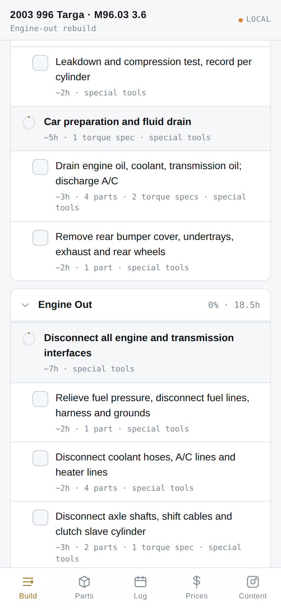

# 996 Rebuild

Parts, procedure and photo log for a full engine-out rebuild of a **2003 Porsche 996 Targa**
— M96.03, 3.6L.

It's a phone-first web app with no server. The rebuild procedure and parts catalog ship with
the app; everything you record lives as JSON in your own Google Drive, alongside every photo
you take in the garage. Two Claude agents read and write that same file — one hunts parts
prices across your vendor accounts, one turns your log into posts.



## What's in it

**Build** — the procedure as a tree: 67 steps across 8 phases, from pre-teardown DME
diagnostics to break-in. Torque specs, special tools and the parts each step needs are
attached to the step. Tick steps off; progress rolls up by estimated hours.

**Parts** — 102 parts with genuine Porsche numbers, LN Engineering and OE alternatives, what
to replace on principle versus inspect first, and running cost. Filter by category or by
status from *needed* through *installed*.

**Log** — the garage journal. Take a photo on your phone, it goes straight to Drive and
attaches to the step you're on. Mark the good ones as hero shots.

**Prices** — vendor quotes, cheapest first, with the spread you're capturing.

**Content** — Instagram captions, reel scripts and long-form build-log drafts, generated
from your log and waiting for approval.

## Getting started

```bash
npm install
cp .env.example .env      # add a Google OAuth client ID — docs/SETUP.md walks through it
npm run dev
```

Then [docs/SETUP.md](docs/SETUP.md) for the Google side and deploying to GitHub Pages,
[docs/AGENTS.md](docs/AGENTS.md) for the two agents, and [docs/CATALOG.md](docs/CATALOG.md)
for working with the factory parts catalogue.

## Part numbers

The factory parts catalogue (Kat 021 / Kat 521, 996 MY98–05) is wired in as a lookup:

```bash
node scripts/catalog.mjs pn 996-107-026-51      # what is this part, does it fit a 2003
node scripts/catalog.mjs find "oil separator"   # search by description
node scripts/catalog.mjs check                  # audit the parts list
```

It is a 2017 snapshot, so it settles what a part *is* and which model years it covers, while
a live dealer catalogue settles what number to order today. The catalogue itself is
copyrighted and stays out of this repo — see [docs/CATALOG.md](docs/CATALOG.md).

## The M96 caveat

The seed data reflects the well-documented failure modes of this engine — IMS bearing, RMS,
cylinder bore scoring, D-chunk case failure, chain ramps — and the research behind it is
cited in the part and step notes. It is a starting point, not a substitute for the factory
manual or for measuring your own engine. Two decisions in particular (which IMS solution,
and whether the cylinders are saveable) can only be made after inspection, and they reshape
the parts list and the budget substantially.

## Stack

React 19 + TypeScript + Vite. No backend, no database, no dependencies beyond React. Google
Drive holds the state; the app uses the `drive.file` OAuth scope, so it can only see files it
created — not the rest of your Drive.
